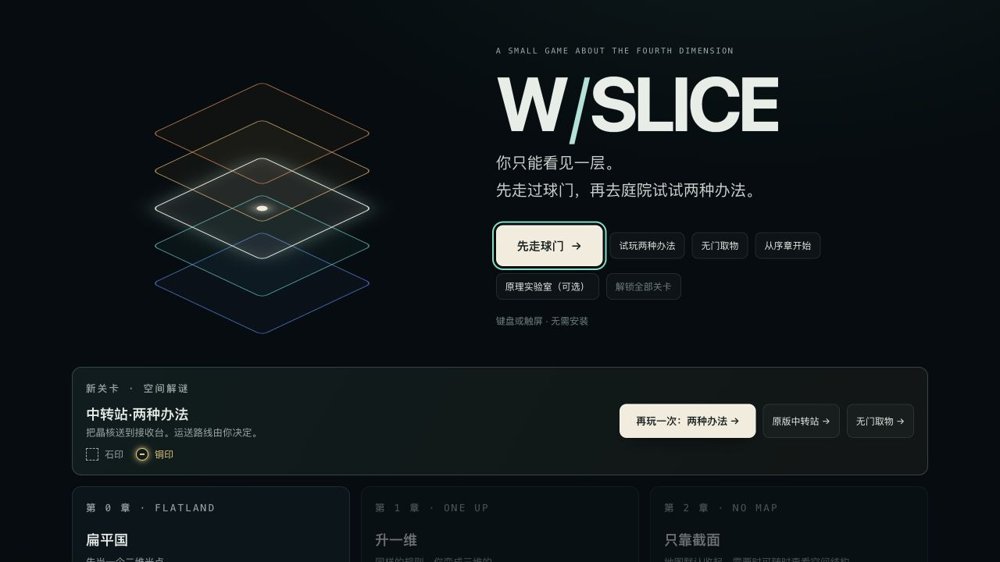
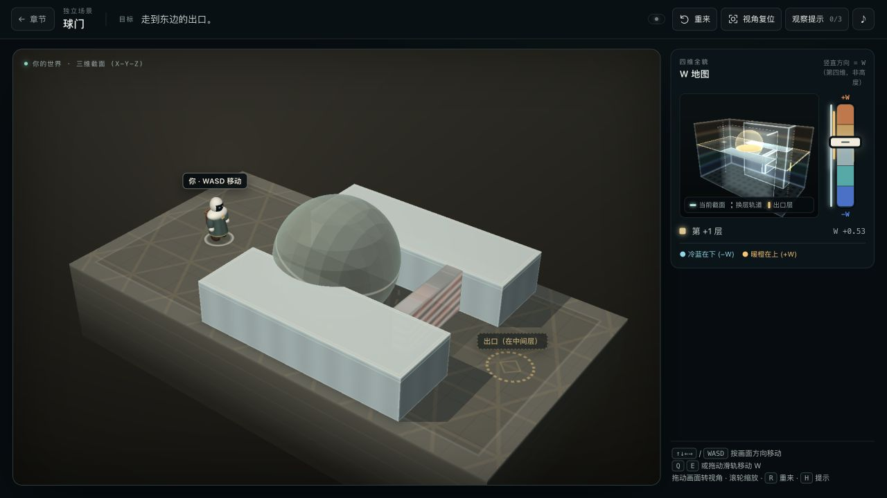
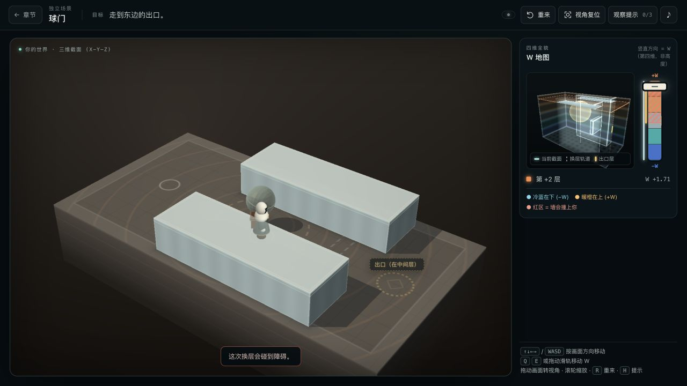
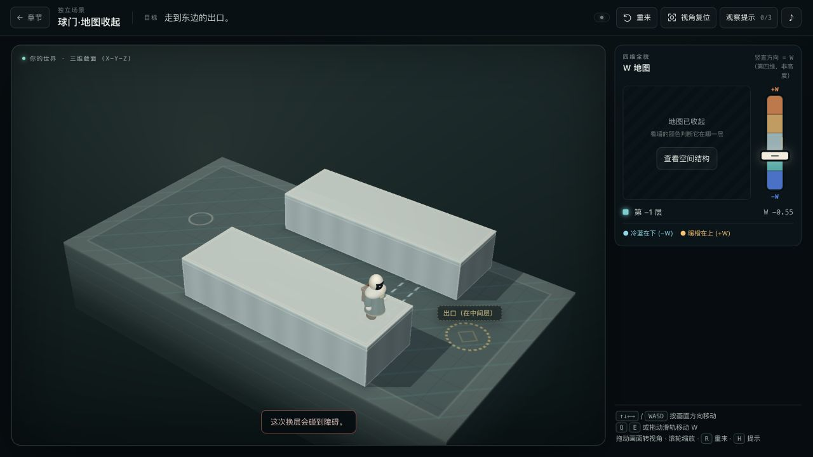
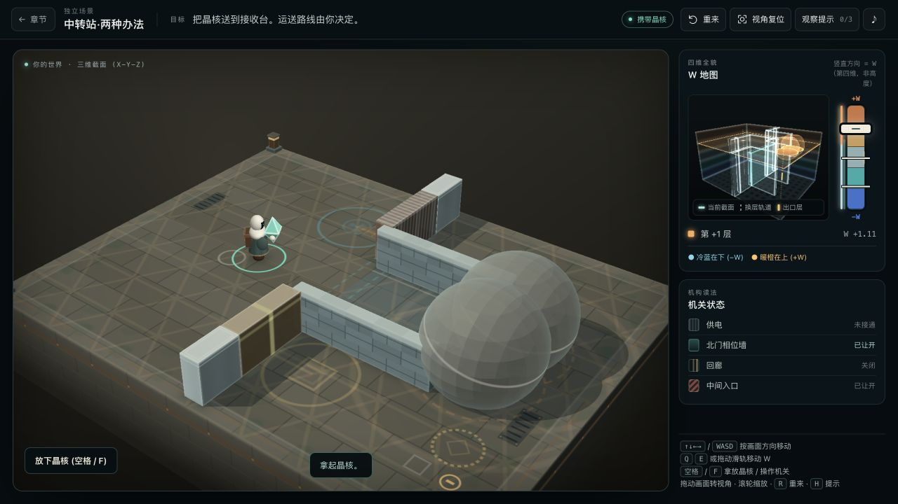
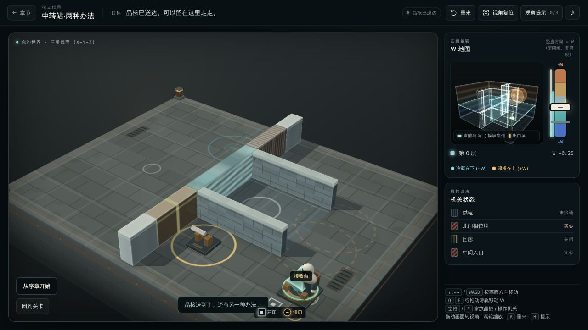
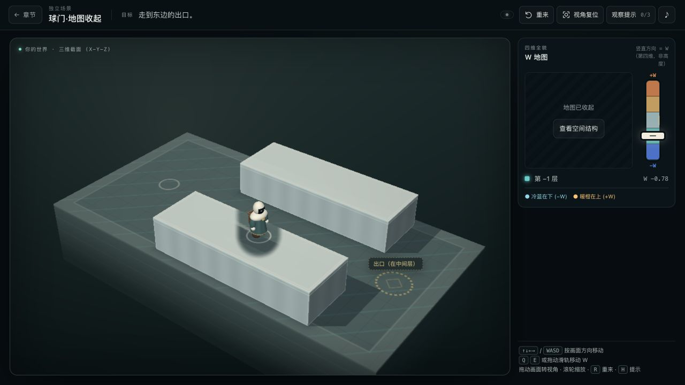
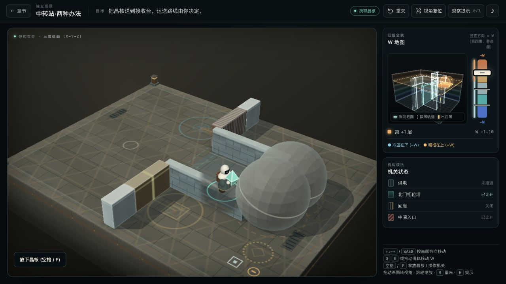

# 球门代理试玩记录

2026-10-23。通过应用内浏览器在 1280×720 视口操作当前本地预览，按画面选择动作，使用键盘移动、Q/E 换层和鼠标转视角。没有注入角色状态，也没有运行路线脚本。首轮只试玩和记录，没有改动游戏代码；按反馈进行的修正与复测记在文末。

试玩者已读过关卡实现与前一轮验证，不能作为首次接触者。浏览器还保留了庭院铜印记录；没有清空用户存档。本次通关与下述感受均为代理观察，G0–G2 仍未判定。

## 实际经过

| 步骤 | 操作与画面 | 判断 |
| --- | --- | --- |
| 1. 首页 | 点击「先走球门」；旁边有「试玩两种办法」 | 主入口清楚，没有进入前的讲解卡 |
| 2. 球门空地 | 短按 E，球变大；继续向暖侧拨，球缩小直至消失，板墙也让开 | 胀缩可见，同一颗球的连续变化容易追踪 |
| 3. 球门窄道与出口 | 在球原位置回拨，被拒绝；走到板墙东侧再回中间层，出口亮起并通关 | 拒绝与出口反馈有效；靠前侧墙时角色脚下被遮挡 |
| 4. 地图收起重走 | 这次向冷侧拨，穿过空路；板墙位置回拨被拒绝；离开其范围后换层到出口 | 未开提示、未查看空间结构即可完成；隐藏地图后站位遮挡更明显 |
| 5. 进入庭院 | 拿起晶核，暖侧打开入口并让两颗矿球显露；走到球前，向冷侧拨让它们缩没 | 矿球切面材质和胀缩行为能与球门对应；庭院初始截面并未显露两颗球 |
| 6. 庭院交付 | 穿过出口球范围，走到接收台，再回中间层交付 | 直接运送路线完成，提示保持 0/3，未使用插座或回廊 |

## 最值得处理的两处

**窄道前侧墙挡住角色脚下。** 在默认视角下，角色靠近前侧墙时只剩上身与淡色透视形象，难以判断自己是否已走出消失板墙的范围。隐藏地图重走时，这一点需要靠一次拒绝反馈确认。抬高视角后地面更清楚，但贴近前墙时仍有遮挡。建议先试相机角度或遮挡物透明处理，保持碰撞几何，不添加安全站位与路线标记。

**隐藏地图面板的说明与当前物体读法不合。** 面板写着「看墙的颜色判断它在哪一层」，眼前的球是灰色矿球，板墙是褐色条纹。它可能引导玩家猜材质颜色对应哪个 W，而不是回想刚才观察到的变化。建议在球门重走中删去这句，保留「地图已收起」与「查看空间结构」。

第一遍实际上选择了暖端空路，第二遍才走冷端。房间仍允许“先扫到空层，再向前走”；这不违反几何规则，却意味着通关本身无法分辨玩家是否形成预测。真人试玩应在下一次换层前记录玩家预期的球大小、出现与否、板墙是否实心，并在庭院两球前再观察一次，避免只记录成功与耗时。

键盘移动、换层、拾取和按钮跳转均可操作；本次没有做屏幕阅读器、触屏或完整无障碍测试。隐藏地图的说明字号较小、对比较弱，加上依赖颜色的措辞，值得单独核查。

## 画面证据

以下均来自本次试玩。完整截图和逐步观察保存在 `output/playwright/slice-gate/agent-playtest/`，观察文件为 `observations.json`。

入口与球的变化：

球门拒绝换层时，角色脚下被前侧墙遮挡：

隐藏地图的说明与板墙拒绝反馈：

进入庭院后，同材质的矿球在暖侧显露，随后完成直接运送：

## 两处修正与复测

同日按用户指定范围修正：固定窄道侧墙挡在相机与角色脚下之间时，在角色周围局部淡化，让鞋、原有脚环和附近地面可见。只处理球门与庭院通道的固定侧墙；球、相位墙保留原有显示。转到背面时，角色身后的墙不淡化。隐藏地图面板删除颜色判断说明，保留「地图已收起」和「查看空间结构」。

本次只修改 `renderer.mjs` 的显示与 `index.html` 的文字。`geometry.mjs`、`game.mjs`、`levels.mjs` 的 SHA-256 与修正前逐一相同，庭院布局、碰撞及吞没换层规则保持不变。没有增加地面站位或路线标记。

复测使用浏览器中的键盘、按钮和视角拖动，结果如下：

| 检查 | 实际结果 |
| --- | --- |
| 首页进入普通球门 | 冷侧穿过窄道，板墙范围外回到中间层，到达出口；通关卡的两个去向仍在 |
| 隐藏地图球门 | 球与板墙位置的吞没换层均被拒绝；离开后可换层通关，提示和查看次数均为 0 |
| 隐藏地图显示 | 地图和滑轨红区默认不可见；拒绝换层时仍只短暂显示相关物体的地面轮廓，已删文字未出现 |
| 庭院直接运送 | 拿起晶核，暖侧穿入口，冷侧穿球，再回中间层交付；携带时脚环也能看见，提示 0/3 |
| 视角与窄屏 | 默认视角下可见脚下；转到背面无错误淡化；390×844 视口无横向溢出，隐藏地图文字正确 |
| 回归检查 | 77 项测试通过，全部 `.mjs` 语法检查与 `git diff --check` 通过 |
| 浏览器运行 | 控制台错误 0；球门、隐藏地图球门、庭院各静止采样 1.5 秒，新增动画帧请求和待执行帧均为 0 |

修正后的截图、测试输出、哈希和浏览器结果保存在 `output/playwright/slice-gate/visibility-fix/`，结果文件为 `verification.json`。这是代理复测，G0–G2 仍需真人试玩。

